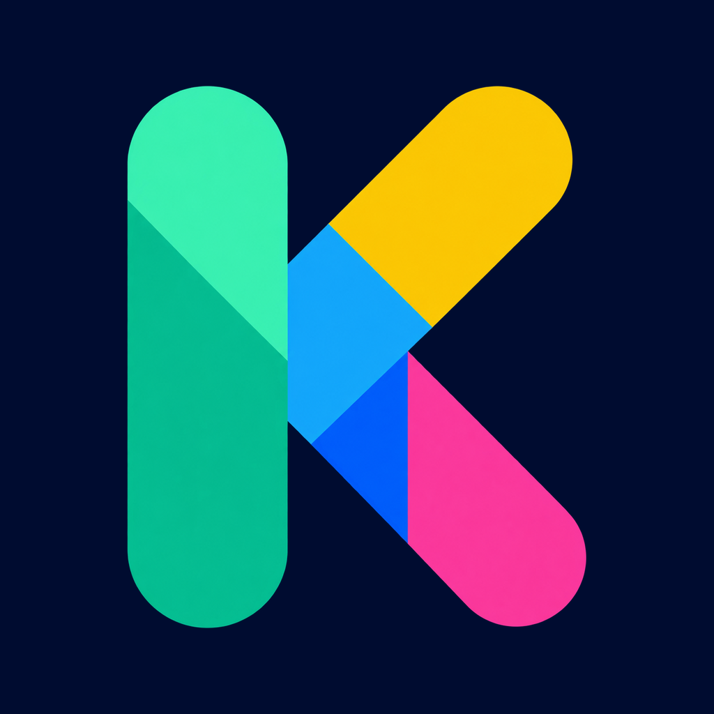
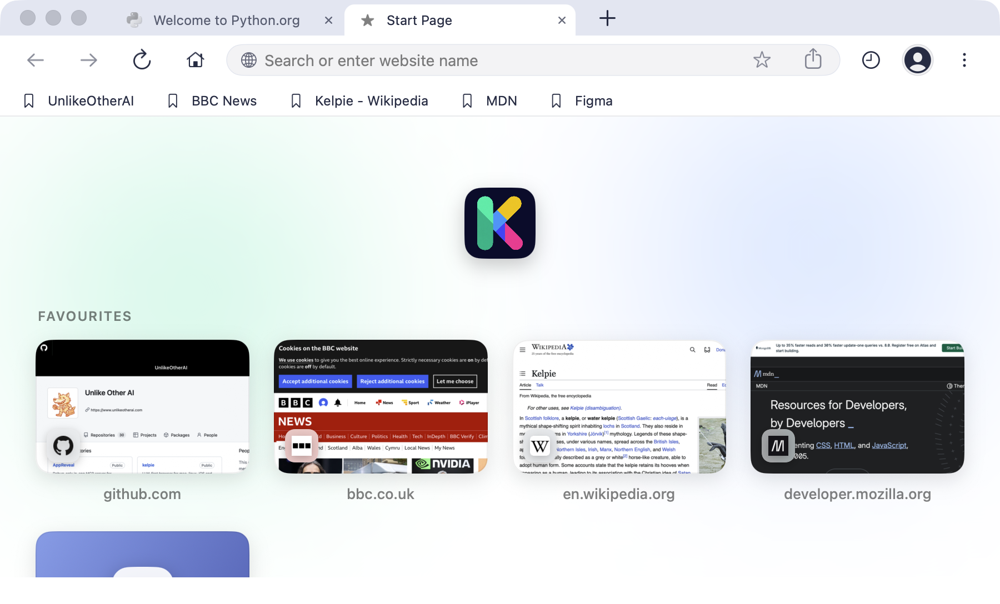
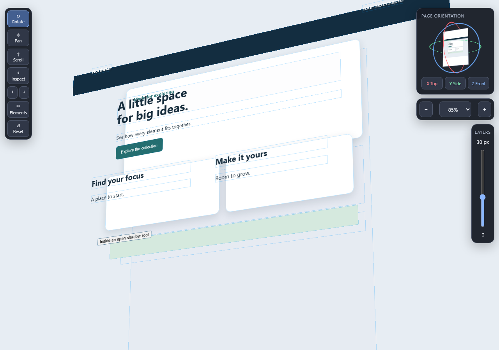

<p align="center">
  
</p>

<h1 align="center">Kelpie</h1>

<p align="center">
  A native browser for people and AI agents.<br>
  Browse on desktop and mobile. Inspect pages in 3D. Connect through MCP, HTTP or the CLI.
</p>

<p align="center">
  <a href="https://github.com/UnlikeOtherAI/kelpie/releases">Download</a> &middot;
  <a href="#quick-start">Quick start</a> &middot;
  <a href="docs/ui/3d-inspector.md">3D inspector</a> &middot;
  <a href="docs/api/">API reference</a> &middot;
  <a href="https://unlikeotherai.github.io/kelpie">Website</a>
</p>

Kelpie is an open-source browser for macOS, Windows, Linux, iOS and Android. Use its native interface yourself, or give an AI agent access to real browser tabs: navigate, read pages, click, fill forms, take screenshots and inspect network traffic.



*The macOS start page brings favourites and recently visited sites into a grid of screenshot cards.*

## What you can do

- **Browse with native controls.** Tabs, bookmarks, history and desktop start pages keep your sites close at hand.
- **Explore a page in 3D.** Rotate its layers, inspect individual elements and move between the header and footer without losing your zoom level.
- **Inspect what happened.** Read network requests, console output and JavaScript errors, or capture annotated screenshots for visual automation.
- **Connect your AI tools.** Use the built-in HTTP/MCP interfaces or the Node.js CLI to control a browser and send group commands across devices.
- **Work on real mobile browsers.** Discover phones and tablets on the local network. AirPlay from an iPhone or iPad to expose an Apple TV as another controllable screen.

Feature coverage varies by platform; see the [API reference](docs/api/) and [feature catalogue](docs/functionality.md).

## Explore the page in 3D

See how a page's elements fit together. The left toolbar switches between Rotate, Pan, Scroll and Inspect. The right side holds a screenshot-based orientation card, zoom controls and a vertical layer-separation slider.



*The 3D inspector at a desktop viewport, displaying an example page.*

Open **Elements** to explore the page tree. Hover an element in the tree or on the page to highlight it; off-screen elements move into view while the camera keeps its zoom and angle. Pan, the up/down buttons and arrow keys let you move along a long page without zooming out.

The inspector is experimental and available on **macOS, iOS and Android**. On macOS, enable it in **Settings → Experimental**, then use the browser's 3D action. [See the inspector controls and platform details](docs/ui/3d-inspector.md).

## Download

[Browse releases](https://github.com/UnlikeOtherAI/kelpie/releases) for downloads, checksums and verification notes. Components are versioned independently.

| Platform | Available builds |
| --- | --- |
| macOS | [Apple Silicon ZIP](https://github.com/UnlikeOtherAI/kelpie/releases), Developer ID signed and notarized |
| Windows | [x64 ZIP](https://github.com/UnlikeOtherAI/kelpie/releases), with signed executables and the Chromium sandbox |
| Linux | [`.deb`, `.rpm`, `.AppImage` and `.tar.gz` packages](https://github.com/UnlikeOtherAI/kelpie/releases); `apt` and `dnf` repositories are available through the [website](https://unlikeotherai.github.io/kelpie) |
| Android | [Signed APK and AAB preview](https://github.com/UnlikeOtherAI/kelpie/releases/tag/release/2026-11-09.1) |
| iOS / iPadOS | [Simulator preview](https://github.com/UnlikeOtherAI/kelpie/releases/tag/release/2026-11-09.1), or [build from source](docs/tech-stack.md#build--run) for a physical device |

## Quick start

Download and open the app for your platform. To control it from a terminal or an AI client, install the CLI with **Node.js 20 or later**:

```sh
npm install -g @unlikeotherai/kelpie
kelpie discover
```

For a discovered macOS, iOS or Android browser, replace `DEVICE_ID` with the identifier returned by discovery. Approve the pairing request in the browser when prompted:

```sh
kelpie --device "DEVICE_ID" pair
kelpie --device "DEVICE_ID" navigate https://example.com
kelpie --device "DEVICE_ID" screenshot
```

Windows and Linux use local browser aliases and their protected readiness tokens. Follow the [Windows](docs/cli.md#windows-aliases-and-agent-stdio) or [Linux](docs/cli.md#linux-aliases-and-agent-stdio) setup to register the downloaded executable and connect your agent.

### Connect an MCP client

For a discovered Mac or mobile browser, add Kelpie to your MCP client's configuration:

```json
{
  "mcpServers": {
    "kelpie": {
      "command": "kelpie",
      "args": ["mcp"]
    }
  }
}
```

For a local browser alias, use `kelpie --browser ALIAS mcp` instead. See the [MCP setup guide](docs/cli/advanced.md#mcp-server) for transports and client options, or run `kelpie --llm-help` for structured command help.

## Build and contribute

Kelpie is open source. See the [build instructions](docs/tech-stack.md#build--run) and [agent guide](AGENTS.md) for platform prerequisites, checks and contribution rules. [Open an issue](https://github.com/UnlikeOtherAI/kelpie/issues) to report a bug or suggest a feature; include the platform, app version and steps to reproduce a problem.

```text
apps/            Standalone hosts for macOS, Windows, Linux, iOS and Android
core/            Embeddable browser UI, platform libraries and shared native code
packages/cli/    Node.js CLI and MCP bridge
packages/shared/ Shared browser-control contracts and TypeScript utilities
docs/            Product, architecture, API, CLI and UI references
```

The embeddable browser keeps its UI, tabs and behaviour in `core/`; standalone apps are thin hosts. See the [embedding contract](core/README.md) to integrate it into another app.

## Documentation

| Guide | Contents |
| --- | --- |
| [Feature catalogue](docs/functionality.md) | Browser features and platform behaviour |
| [3D inspector](docs/ui/3d-inspector.md) | Camera tools, layer separation and the element toolbox |
| [CLI reference](docs/cli.md) | Discovery, pairing, commands and browser aliases |
| [API reference](docs/api/) | HTTP and MCP methods |
| [Architecture](docs/architecture.md) | Components, data flow and protocols |
| [Tech stack and builds](docs/tech-stack.md) | Dependencies and platform build instructions |
| [Product brief](docs/brief.md) | Product scope and goals |

[AppReveal](https://github.com/UnlikeOtherAI/AppReveal) supports Kelpie's debug automation. Its in-app SDK is excluded from release builds; see [developer notes](docs.md).

## License

[Apache License 2.0](LICENSE).
